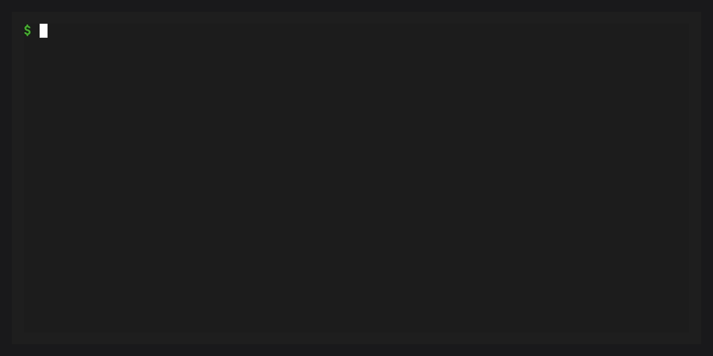

# Quick start

This guide uses native conda to install a plugin and conda-self to protect
and maintain base.

## Prerequisites

- Use conda 26.11.0 or later and Python 3.11 or later.
- Install conda-self in base.

## Protect your base environment


If your installer already protected base, skip to {ref}`quickstart-install-plugin`.
Otherwise, check whether base is protected with
[conda doctor](inv:conda:std:doc#commands/doctor).

```bash
conda doctor -n base base-protection
```

For an unprotected base, enable protection with this command.

```bash
conda doctor -n base base-protection --fix
```

This does four things:

1. Shows the full migration plan and saves a recovery snapshot after confirmation
2. Clones base to `default` and removes the planned conda management packages
3. Retains conda, its plugins, configured permanent packages, installer-snapshot
   packages, and their dependencies in base
4. Marks base as frozen so regular conda commands refuse to modify it unless
   `--override-frozen` is passed

(quickstart-install-plugin)=
## Install a plugin

With conda 26.11.0 or later, use the native command to install `conda-index`
into base. Conda checks that the package provides a plugin before installing it.

```bash
conda plugins install -n base conda-index
```

For frozen base, see the {doc}`reference/cli` for the prompt and version
details.

## Update all installed packages

```bash
conda self update --all
```

This updates every installed package in the base environment.

## Remove a plugin


```bash
conda self remove conda-index
```

Conda-self protects conda, conda-self, configured permanent packages, and their
dependencies from direct removal requests unless `--force` is passed. Conda's
own transaction checks still apply.

## Reset base



If something goes wrong, automatically select a reset mode:

```bash
conda self reset
```

## Next steps

- {doc}`tutorials/protecting-base` -- A deeper walkthrough of base
  protection and what happens under the hood
- {doc}`tutorials/managing-plugins` -- Install, update, and remove
  plugins with confidence
- {doc}`features` -- How base protection, snapshots, and plugin
  validation work
- {doc}`reference/cli` -- Every command and flag
