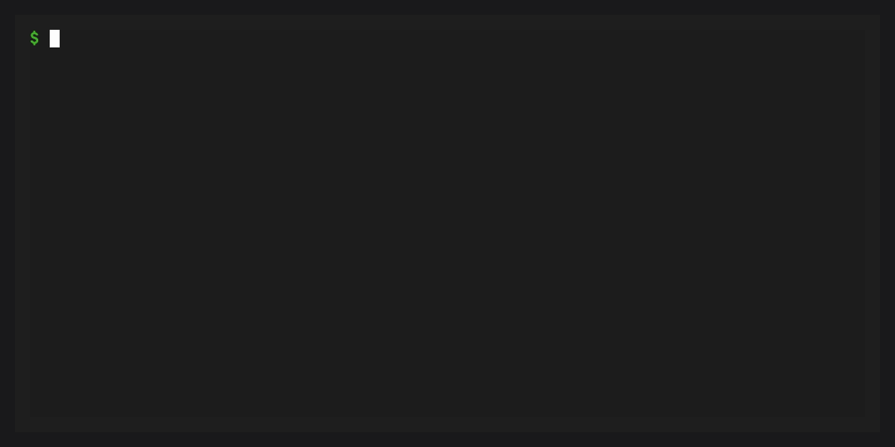

# Managing plugins

This tutorial covers the complete lifecycle of
[conda plugins](inv:conda:std:doc#dev-guide/plugins/index) in a protected base
environment: installing, updating, and removing them.

## Prerequisites

- conda 26.11.0 or later and Python 3.11 or later
- conda-self installed in base for the update and remove steps
- Base environment protected (see {doc}`protecting-base`)

## Install a plugin

Target base by name, even if another environment is active.

```bash
conda plugins install -n base conda-index
```

Conda checks the freeze marker and verifies that the package provides a
plugin before installing it. See the {doc}`../reference/cli` for freeze
prompt details.

:::{dropdown} Watch an installation with the older command

:::

### Multiple plugins at once

```bash
conda plugins install -n base conda-index conda-spawn
```

## Update plugins


Update conda:

```bash
conda self update
```

Update a specific plugin:

```bash
conda self update --plugin conda-index
```

Update all installed packages:

```bash
conda self update --all
```

Force reinstall:

```bash
conda self update --force-reinstall
```

## Remove a plugin


```bash
conda self remove conda-index
```

Conda-self protects conda, conda-self, configured permanent packages, and their
dependencies from direct removal requests unless `--force` is passed. If you
try without `--force`, you will see a `PluginRemoveError`. Conda's own
transaction checks still apply with `--force`.

## Channel configuration

conda-self uses your configured channels. Use
[conda config](inv:conda:std:doc#commands/config) to add or change channels
before installing. To install plugins from a custom channel:

```bash
# Add the channel first
conda config --add channels my-channel -n base

# Then install
conda plugins install -n base my-plugin
```

Configuring the channel also makes it available to later updates. The older
`conda self install` command rejects channel-qualified package specs such as
`conda-forge::my-plugin`.

## Next steps

- {doc}`../guides/resetting-base` -- Restore base from a snapshot
- {doc}`../guides/custom-channels` -- Use custom channels for plugins
- {doc}`../reference/cli` -- Full CLI reference
