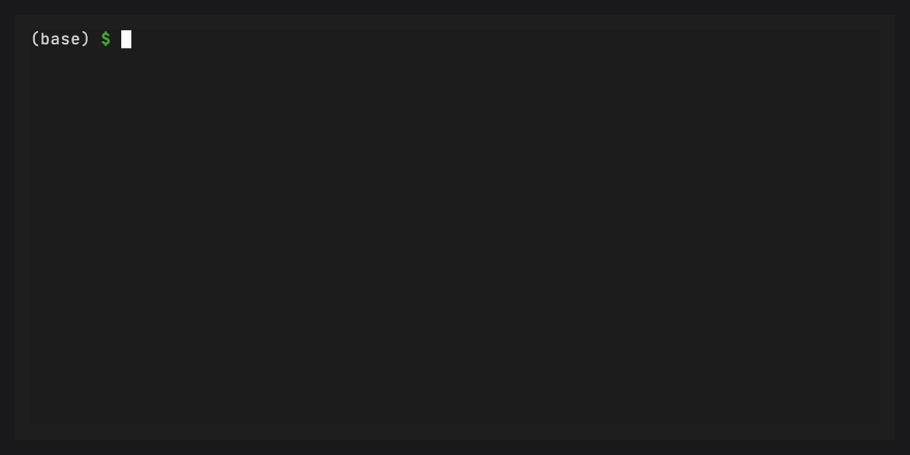

# Protecting your base environment

This tutorial walks through setting up base environment protection
from scratch and understanding what happens at each step.

## Before you start

Verify conda-self is available (install with `conda install -n base conda-self`):

```bash
conda self --version
```

## Check current status

First, see if base is already protected with [conda doctor](inv:conda:std:doc#commands/doctor):

```bash
conda doctor -n base base-protection
```

If base is not protected, you will see a message indicating that the
health check found an issue.

## Enable protection



Run the fix:

```bash
conda doctor -n base base-protection --fix
```

The command shows a complete migration plan before asking for confirmation,
including in quiet mode. The plan lists the exact versions and builds retained
in base and installed in `default`, packages excluded from `default`, and any
packages removed from both environments. It also shows whether an existing
`default` will be replaced and how default activation will change.

No dependency solve runs. Retained packages keep their installed versions and
builds. A package that requires conda or one of its plugins cannot be moved to
`default` unchanged, so the plan lists it as unavailable there. Review these
omissions before confirming.

To inspect the plan without changing environments:

```bash
conda doctor -n base base-protection --fix --dry-run
```

After confirmation, these steps run:

### Step 1: Save a snapshot

conda-self saves a snapshot of base in conda's explicit format to
`conda-meta/base-protection-state.explicit.txt`. The file contains an
`@EXPLICIT` marker followed by the complete URL for each conda package in the
environment before the reset, enabling exact restoration later. Migration stops
before making changes if this recovery snapshot cannot be prepared.

### Step 2: Clone base to default

Your current base environment is cloned to a new environment called
`default`. Conda, its plugins, packages requiring them, and dependencies used
only by them are removed from the clone according to the plan. Shared and
independently requested dependencies remain. Untracked files are copied.

The resulting package set and retained versions are checked before base is
reset. If destination preparation fails, base remains unchanged.

```bash
conda activate default
```

### Step 3: Reset base

Base retains conda, conda-self, all detected conda plugins, configured permanent
packages, and installed conda packages named in the installer snapshot when that
file exists. Their current dependencies are retained as well. Other conda
packages are removed according to the plan.

### Step 4: Mark base as frozen

The `conda-meta/frozen` environment marker file is written, marking base as
frozen. Regular conda commands refuse to modify it unless `--override-frozen`
is passed. `conda self update` and `conda self remove` pass that option to
conda. For plugin installation, see {doc}`managing-plugins`.

## Verify protection

Run the health check again:

```bash
conda doctor -n base base-protection
```

It should now report that base is protected.

Try installing a regular package into base:

```bash
conda install -n base numpy
```

This will fail with a frozen environment error. That is the expected
behavior.

## Use the default environment

The user packages retained by the migration plan are in `default`:

```bash
conda activate default
python -c "import numpy; print(numpy.__version__)"
```

## External packages

The preview lists external Python packages and untracked Python files copied
to `default`. Existing libraries are retained conservatively when these files
are present, since Python metadata cannot describe every native-library
requirement. External files also remain in base, where they may stop working
after the base reset.

Migration temporarily disables prefix-data interoperability so planning,
cloning, and removal consistently use the conda package records. External
package inspection still runs. The previous setting is restored afterward,
including on cancellation or failure.

An externally installed conda plugin must first be installed as a conda package.
Migration stops before making changes if package metadata is unreadable or an
external package declares a requirement on a package excluded from `default`.
Optional Python requirements are treated conservatively as well. External
`.pth` and `.egg-link` import redirects must be resolved before migration.

If protection fails after resetting base, keep the prepared `default`
environment and recovery snapshot. Restore base with
`conda self reset --snapshot base-protection` before retrying. If base was
frozen successfully but activation configuration failed, finish with
`conda config --set default_activation_env default`.

## Existing protected installations

This command continues to skip an already protected base. It does not clean up
`default` environments created by earlier migrations.

## Next steps

- {doc}`managing-plugins` -- Install plugins safely in the protected base
- {doc}`../guides/resetting-base` -- Restore base from a snapshot
- {doc}`../reference/cli` -- Full CLI reference
